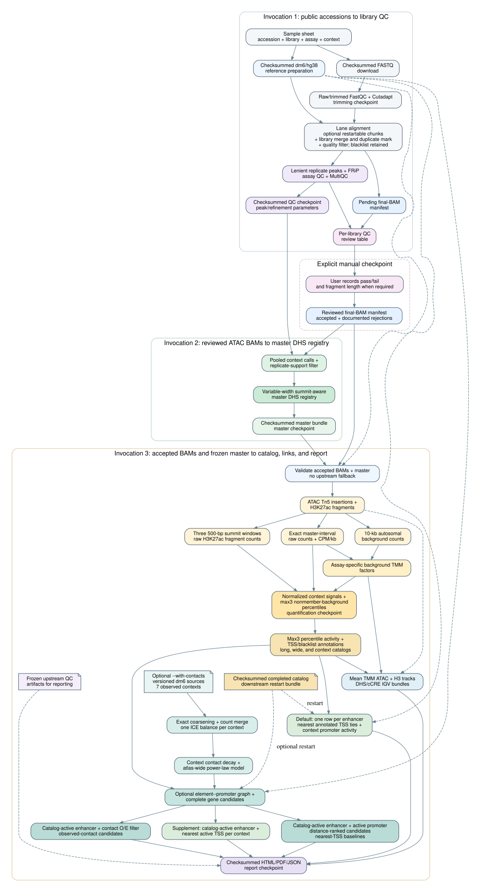

# Drosophila cCREs

Reproducible processing of public ATAC-seq and H3K27ac data from accessions to
a summit-aware master DHS registry, a context-resolved catalog of candidate
cis-regulatory elements, and a nearest-TSS annotation of every enhancer-like
element.

The published dm6 atlas covers eight contexts (`ab`, `e13`, `e5`, `ead`, `hid`,
`lb`, `o`, `wid`) built from 20 ATAC-seq and 14 IP-only H3K27ac biological
libraries. The complete input is versioned in `resources/`:

| File | Content |
|---|---|
| `resources/atlas_samples.tsv` | 35 public accessions (34 biological libraries) |
| `resources/atlas_qc_decisions.tsv` | Recorded per-library QC decisions and reviewed single-end H3K27ac fragment lengths |

The workflow has three invocations separated by an explicit library-QC gate:

1. **Reads to QC.** Download, trim, align, filter, call per-library peaks and
   write a library review table.
2. **Master DHS registry.** Pool accepted ATAC libraries by context, keep
   replicate-supported peaks and cluster them into a summit-aware registry.
3. **Element catalog.** Quantify ATAC and H3K27ac on the registry, call
   context-specific H3K27ac activity, annotate TSS-distance classes, assign
   each enhancer-like element to its nearest annotated TSS, and render an
   integrated QC report.

## Installation

Prerequisites are a POSIX shell, Git and `mamba`. Keep every environment inside
the repository:

```bash
export MAMBA_ROOT_PREFIX="$PWD/.micromamba"
export CONDA_PKGS_DIRS="$PWD/.micromamba/pkgs"
export CONDA_ENVS_PATH="$PWD/.micromamba/envs"
export CONDARC="$PWD/.condarc"
export XDG_CACHE_HOME="$PWD/.cache"
mamba env create --prefix "$PWD/.venv" --file environment.yml
mamba activate "$PWD/.venv"
python src/run_pipeline.py --help
```

The local Snakemake profile creates pinned rule environments below
`.snakemake/conda` on first use, so the first run needs network access.
Snakemake runs with its local executor, including inside a site-specific
`sbatch` allocation.

## Reproducing the atlas

Validate the input table:

```bash
python src/validate_sample_sheet.py resources/atlas_samples.tsv
```

**1. Accessions to QC.** One mixed table produces one QC namespace per assay,
`results/drosophila-atlas.atac.dm6/<run>` and
`results/drosophila-atlas.chip_histone.dm6/<run>`:

```bash
python src/run_pipeline.py resources/atlas_samples.tsv \
  --project drosophila-atlas --run-id qc-v1 --genome dm6 \
  --until-stage qc --cores 16
```

Add `--alignment-chunk-pairs 2000000` for restartable alignment of very large
lanes.

**2. Apply the QC decisions.** The versioned table holds one decision per
library; `--assay` selects the rows for each per-assay manifest:

```bash
for assay in atac h3k27ac; do
  ns=$([ "$assay" = atac ] && echo atac || echo chip_histone)
  python src/review_final_bam_manifest.py \
    results/drosophila-atlas.$ns.dm6/qc-v1/provenance/manifests/final-bams.tsv \
    --review-table resources/atlas_qc_decisions.tsv --assay "$assay" \
    --output data/reviewed/$assay.reviewed.tsv
done
```

For a new dataset, copy the generated `qc/library-review.tsv`, fill
`qc_decision` (`pass`/`fail`, a failure needs `notes`) and, for single-end
H3K27ac, review the pre-filled `estimated_fragment_length_bp`.

**3. Master DHS registry** from the completed QC checkpoint and the reviewed
ATAC manifest. Strict reuse: nothing is downloaded or realigned.

```bash
python src/run_pipeline.py resources/atlas_samples.tsv \
  --from-stage qc \
  --checkpoint-manifest \
    results/drosophila-atlas.atac.dm6/qc-v1/provenance/manifests/qc.checkpoint.json \
  --final-bam-manifest data/reviewed/atac.reviewed.tsv \
  --project drosophila-atlas --run-id master-v1 --genome dm6 \
  --until-stage master --cores 16
```

**4. Quantification, catalog, nearest-TSS links and report:**

```bash
python src/run_pipeline.py resources/atlas_samples.tsv \
  --from-stage master \
  --master-manifest \
    results/drosophila-atlas/master-v1/provenance/manifests/master-dhs.tsv \
  --activity-bam-manifest data/reviewed/atac.reviewed.tsv \
  --activity-bam-manifest data/reviewed/h3k27ac.reviewed.tsv \
  --report-source-root results/drosophila-atlas.atac.dm6/qc-v1 \
  --report-source-root results/drosophila-atlas.chip_histone.dm6/qc-v1 \
  --project drosophila-atlas --run-id catalog-v1 --genome dm6 \
  --until-stage report --cores 16
```

The H3K27ac activity cutoff defaults to a background percentile of 0.60. Pass
`--h3k27ac-activity-threshold T` (0 < T < 1) to this command to use another
value; because it changes the scientific result, it needs a new `--run-id`.

Add `--snakemake-dry-run` to any command to inspect the planned jobs.
`--cores` limits total cores and `--jobs` concurrent cluster jobs.

## Pipeline DAG



The graph source is [`docs/workflow-dag.dot`](docs/workflow-dag.dot). The
methods, with equations, are in
[`docs/pipeline-description.pdf`](docs/pipeline-description.pdf).

## Input table

The input is a CSV or TSV conforming to `schemas/sample-sheet.schema.yaml`:

| Column | Meaning |
|---|---|
| `accession` | Public run or experiment accession (SRR/SRX/ERR/ERX) |
| `library_id` | Biological library; technical runs share an ID |
| `assay` | `atac` or `h3k27ac` |
| `context` | Tissue or stage |

Rows sharing a `library_id` are technical runs: their lanes are processed
separately and merged before duplicate marking. Distinct ATAC libraries in one
`context` are biological replicates and are pooled automatically; each context
needs at least two. H3K27ac libraries are IP-only: input-control columns are
rejected and MACS3 estimates its local lambda from the IP. Optional per-row
processing overrides (adapters, trimming, alignment, MACS3 parameters) are
documented in the schema; the atlas uses the defaults throughout. The genome
is the project-level `--genome dm6`.

## Method summary

### Reads, alignment and library QC

- FASTQs are downloaded with checksum verification and resume state, then kept
  immutable. ENA is used first; only ENA failures fall back to SRA Toolkit.
- Each lane is trimmed (Cutadapt; Nextera adapters for ATAC, TruSeq for
  H3K27ac) and aligned with Bowtie 2 (`--very-sensitive`, fragments up to
  2,000 bp). Technical lanes merge by `library_id` before duplicate marking.
- Final BAMs remove unmapped, secondary, QC-fail, supplementary, duplicate,
  MAPQ < 30 and mitochondrial alignments. Reads overlapping the reference
  blacklist are retained (filtering contract `short-read-processing-final-v2`);
  blacklist overlap is annotated on elements instead.
- QC reports FRiP, peak counts, ATAC TSS enrichment and fragment-length
  distributions, H3K27ac phantompeakqualtools cross-correlation, and MultiQC.
  Paired-end FRiP counts one valid fragment per read pair; single-end FRiP
  counts filtered reads. TSS enrichment is the maximum central ±50-bp signal
  over the mean of the two terminal 100-bp flanks of the ±2-kb profile.
- H3K27ac QC peaks use MACS3 `callpeak --broad --broad-cutoff 0.1 -q 0.01 -B
  --SPMR` without `-c`. They are QC evidence only; the catalog is quantified
  directly from BAM-derived units.

### Master DHS registry

- Paired-end ATAC keeps proper pairs with `0 < abs(TLEN) < 150`, applies Tn5
  offsets and converts both mates to one-base insertions.
- MACS3 runs on the insertions with `-f BED --nomodel --shift -75 --extsize 150
  --keep-dup all -B -q 0.10` (no `--SPMR`). Qpois is computed with
  `macs3 bdgcmp -m qpois` from the unscaled pileup and local lambda.
- Qpois refinement evaluates exponents 2–325 and keeps 50–400-bp components,
  so broad components split as the exponent rises. Refined boundaries are not
  an independent FDR-controlled call.
- Libraries are pooled by `context`. A context peak is retained when at least
  two biological libraries cover the configured fraction (0.5) of it.
- Context peaks are clustered with summits taken from the pooled context
  signal. A cluster requires reciprocal summit containment, a complete-linkage
  summit span of at most 150 bp and at most one peak per context. Adjacent
  clusters whose representative summits are under 50 bp apart merge only when
  their context sets are disjoint. The registry is not an interval union or a
  fixed-width resize.

### Quantification

- Assay units: ATAC one-base insertions (as above); paired-end H3K27ac one
  fragment per proper pair; single-end H3K27ac reads extended to the reviewed
  fragment length.
- TMM factors are estimated separately for ATAC and H3K27ac from raw counts in
  fixed 10-kb autosomal background bins. Context values are equal-weight means
  of the normalized biological libraries.
- ATAC is counted over each exact variable-width DHS. H3K27ac is counted in
  three clipped, non-overlapping 500-bp windows,
  `[summit-750, summit-250)`, `[summit-250, summit+250)` and
  `[summit+250, summit+750)`. The max3 signal is the largest
  background-TMM-normalized CPM/kb among them (ties: center, left, right).
- For each context, the max3 signals of blacklist-clear DHSs that are **not**
  members of that context form the empirical background. Every DHS receives a
  midrank percentile against it and an upper-tail probability
  `(1 + #(background >= signal)) / (1 + background_n)`.

### H3K27ac activity and blacklist flag

A DHS is active in a context when it is a member of that context and its max3
background percentile is **strictly greater than** the configured threshold
(default 0.60). Its `activity_state` is then
`active_h3k27ac_background_gt_<threshold>`. Non-members are
`inactive_in_context`; members that do not pass are
`below_h3k27ac_background_threshold`, or `accessible_no_h3k27ac_signal` when
their max3 signal is zero.

Blacklist-overlapping DHSs are never removed. They are excluded from the
background population, but members are tested with the same rule as every
other element and keep their call. `blacklist_overlap` (1 when any DHS base
overlaps the reference blacklist), `blacklist_overlap_bp` and
`blacklist_overlap_fraction` flag them in every catalog table. Filter on
`blacklist_overlap == 0` for a blacklist-clear set.

### Regulatory classes

Absolute distance from the DHS summit to the nearest annotated TSS:

| Class | Distance |
|---|---:|
| `promoter_associated` | ≤ 500 bp |
| `proximal_enhancer_like` | 501–1,000 bp |
| `distal_enhancer_like` | > 1,000 bp |
| `unclassified_no_tss_on_contig` | no TSS on that contig |

Enhancer-like means proximal or distal. Classes describe location,
accessibility and acetylation; they are not functional validation.

### Nearest-TSS annotation

`links/nearest_tss/enhancer_nearest_tss_candidates_wide.tsv.gz` has exactly one
row per enhancer-like element, whatever its activity. Each is assigned the
annotated TSS (one promoter per distinct GTF gene/TSS) with the minimum
absolute summit distance on the same chromosome; exact ties stay in the same
row as aligned, semicolon-separated fields. The row carries the element's
`blacklist_overlap` flag and, per context, its membership, ATAC signal,
H3K27ac percentile, activity call and state.

Per context, a nearest promoter is active when a blacklist-clear,
context-member DHS summit within an inclusive ±500 bp of the exact TSS has the
activity call. Promoter signal and score columns use the same blacklist-clear
supporting DHSs; the promoter activity score is the maximum of
`sqrt(ATAC × H3K27ac) × percentile` over those DHSs. Promoter activity
annotates the assigned TSS; it never changes which TSS is nearest.

### Browser tracks

Per context, the catalog writes a DHS BED and a BED9 element track. In the
element track the thick interval marks the summit, the score is the background
percentile × 1,000, the colour encodes the TSS class and blacklist-overlapping
elements are black. The name records class, TSS distance, percentile, activity
call/state and blacklist status. Mean background-TMM BigWigs use the same TMM
factors; each ATAC insertion is drawn as a centered 150-bp interval. IGV
sessions (`igv/<context>.xml`, `all-contexts.igv.xml`) load the master
registry, both mean tracks, the DHS and the element tracks with relative
paths.

## Stages and restart behavior

`--until-stage` selects the stopping boundary:

| Stage | Completed result |
|---|---|
| `trimming` | raw/trimmed FastQC, Cutadapt metrics, trimmed FASTQs |
| `alignment` | filtered final BAM/BAI, alignment QC, final-BAM manifest |
| `qc` | peaks, FRiP, assay QC, MultiQC, library review table |
| `master` | replicate-supported context peaks and the master DHS bundle |
| `quantification` | raw, CPM/kb and background-TMM signals, max3 H3K27ac signals and background percentiles |
| `catalog` | activity calls, long/wide/per-context tables, BED/BigWig tracks, IGV sessions |
| `links` | promoter registry and the wide nearest-TSS enhancer table |
| `report` | integrated, checksummed HTML/PDF QC report |

Re-running the same `--project`/`--run-id` resumes from valid outputs;
Snakemake owns completeness and profiles keep `rerun-incomplete: true`.
Changing selected libraries or any scientific parameter requires a new
`--run-id`; the resolved configuration's semantic digest guards each run
namespace.

Every endpoint exports `provenance/manifests/<stage>.checkpoint.json` (paths,
parameters, SHA-256 hashes and the semantic digest) and an immutable
`provenance/configs/<stage>.resolved_config.json`. Starting from a boundary is
strict: missing or changed artifacts are an error, never a silent upstream
recomputation.

| `--from-stage` | Required artifact | Allowed stopping points |
|---|---|---|
| `accessions` | accession table | trimming through QC |
| `trimming` | trimming `--checkpoint-manifest` | trimming, alignment or QC (same run) |
| `alignment` | alignment checkpoint or `--final-bam-manifest` | alignment or QC |
| `qc` | QC checkpoint; reviewed ATAC `--final-bam-manifest` for master | QC or master |
| `master` | `--master-manifest`; reviewed BAM manifests when continuing | master through report |
| `quantification` | quantification checkpoint | quantification through report |
| `catalog` | catalog checkpoint, or `--catalog-manifest` for an exported catalog | catalog through report; links only from a manifest |
| `links` | links checkpoint | links or report |
| `report` | report checkpoint | report validation |

New BAMs are exported as `pending_review`. Master construction refuses any
pending ATAC library and records documented rejections; quantification
requires reviewed ATAC and H3K27ac manifests. `final-bam` is a compatibility
alias of `alignment`.

A completed catalog can enter the links stage in a new namespace without
revalidating its BAMs:

```bash
python src/create_catalog_manifest.py results/drosophila-atlas/catalog-v1 \
  --output data/reviewed/atlas-catalog.tsv
python src/run_pipeline.py resources/atlas_samples.tsv \
  --from-stage catalog --until-stage links \
  --catalog-manifest data/reviewed/atlas-catalog.tsv \
  --project drosophila-atlas --run-id links-v1 --genome dm6
```

`work/<project>/<run_id>/` holds reproducible intermediates; large ones are
temporary and removed after their last consumer. Quantification units are kept
below `activity/quantification/units/` because catalog restarts need them.

## Outputs

```text
results/<project>/<run_id>/
├── atac/master/                      master_dhs.bed, master_dhs_summits.bed,
│                                     master_dhs_membership.tsv,
│                                     master_dhs_context_matrix.tsv, master_dhs.json
├── activity/quantification/          normalization_factors.tsv, context_signal.tsv.gz,
│                                     master_dhs_activity.tsv.gz, h3k27ac/master_dhs_signal.tsv.gz,
│                                     per-library signals, window counts, metrics, provenance
├── activity/catalog/
│   ├── master_elements_long.tsv.gz   one row per DHS × context
│   ├── master_elements_wide.tsv.gz   one row per DHS, context-prefixed columns
│   ├── elements/<context>.elements.tsv.gz   context members only
│   ├── regulatory_element_summary.tsv       counts by context/class/blacklist/activity
│   ├── regulatory_element_metrics.json      definitions, threshold, counts
│   ├── regulatory_element_provenance.json
│   ├── bed/  tracks/  igv/  all-contexts.igv.xml
├── activity/links/nearest_tss/       promoters.tsv.gz, enhancer_nearest_tss_candidates_wide.tsv.gz,
│                                     and their metrics
├── activity/report/                  integrated_qc_report.{html,pdf,json}
└── provenance/                       resolved configs and stage checkpoints
```

The catalog tables report raw and normalized max3 signal, the continuous
background percentile and upper-tail probability, the activity call and state,
TSS distance and class, and the blacklist annotations, so stricter cutoffs can
be applied without recounting. The report records every input and output hash
and matches upstream QC rows to the selected BAMs by checksum.

## Verification

```bash
pytest -q
snakemake --snakefile workflow/Snakefile \
  --configfile tests/fixtures/workflow_config.yaml --lint
snakemake --snakefile workflow/Snakefile \
  --configfile tests/fixtures/workflow_config.yaml --cores 8 --dry-run
git diff --check
```

The loopback aria2 integration test may need socket permission in a sandbox.
